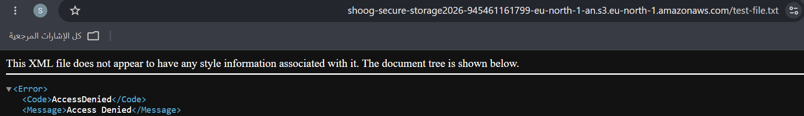

# Secure Cloud Storage on AWS

## Project Overview
This hands-on project demonstrates how to configure secure cloud storage using Amazon S3 and apply fundamental cloud security practices.

## Objectives
- Store files privately in Amazon S3.
- Prevent public access to the S3 bucket.
- Enable server-side encryption.
- Enable S3 Versioning.
- Apply a bucket policy to deny insecure transport.
- Review management events using AWS CloudTrail Event history.

## AWS Services
- Amazon S3
- AWS CloudTrail

## Security Configurations
- **Block Public Access:** Enabled.
- **Object Ownership:** Bucket owner enforced; ACLs disabled.
- **Default Encryption:** SSE-S3.
- **Versioning:** Enabled.
- **Transport Security:** Bucket policy denies requests when `aws:SecureTransport` is `false`.

## Validation and Testing
- Accessed an object URL without authentication and received `AccessDenied`.
- Confirmed that the bucket policy includes the insecure transport restriction.
- Verified that two versions of the test file exist.
- Confirmed that the default encryption setting uses SSE-S3.
- Reviewed S3 management events in CloudTrail Event history.

## Learning Outcomes
- Practiced configuring Amazon S3 security settings.
- Learned the role of bucket policies and public access controls.
- Explored encryption, object versioning, and CloudTrail management events.
- Practiced validating cloud security configurations.

## Notes
This is a learning project. The tests validate the configurations listed above and do not represent a complete security audit or penetration test.

## Project Screenshots

### Default Encryption

### Bucket Versioning

### Block Public Access

### Access Denied Test

